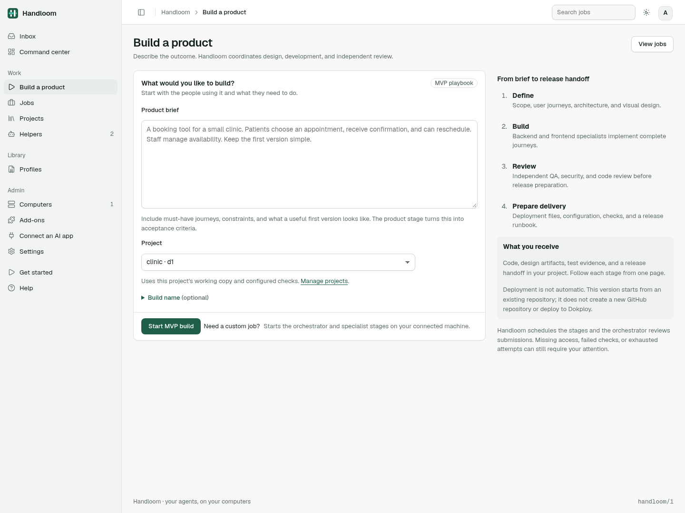
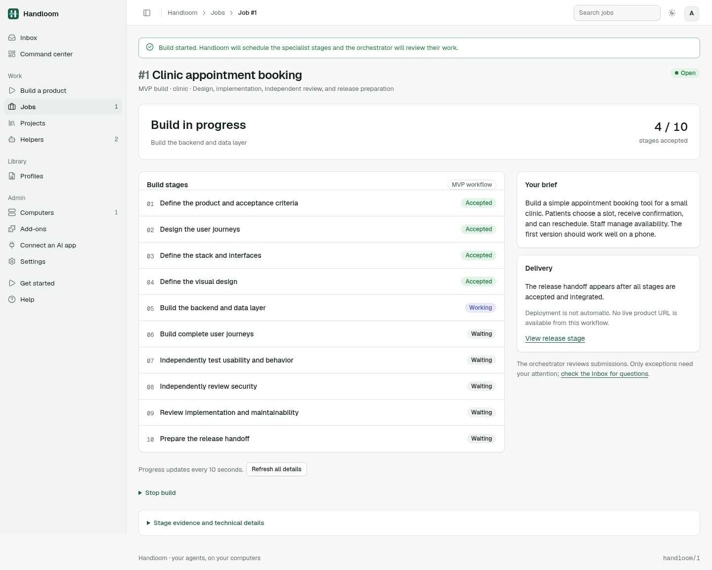

# Product-building UX review

Reviewed and implemented on 2026-11-01. The previous MVP milestone added a stage
table to the existing job page; it did not replace the manual coordination UX.

## Findings and changes

| Problem | Change |
| --- | --- |
| The primary entry point asks users to configure a job, choose profiles, and understand machines. | **Build a product** in navigation, Jobs, and Overview opens `/build`. Everyday inputs are a brief and a prepared project; naming is optional. |
| The web UI cannot launch the new MVP playbook. | The form uses the same atomic, idempotent launch operation as the CLI. One-time team setup is available to workspace owners, preserving existing profiles. |
| Setup failures appear late and can strand the user's work. | Show missing team/project prerequisites before launch. Keep the brief and operation ID through setup and server validation failures. Offer only authorized, joined machines with ready project copies and configured checks. |
| The job page leads with operational details and repeats ten expanded task panels. | Managed builds lead with the current state, accepted-stage count, stage sequence, original brief, and delivery expectations. Evidence and technical controls are in an expandable section. Stage links reload current evidence and open that section. |
| Internal scheduling instructions appear as part of the user's brief. | Read the original brief from the stored product request. |
| “Ready for you” implies routine human approval, and reassignment controls are refused by the managed-plan backend. | Say “Under review,” explain the orchestrator's responsibility, and remove incompatible reassignment controls. Manual intervention remains available in technical details. |
| Accepted tasks can be mistaken for an integrated release. | Separate acceptance, integration, integration failure, and release readiness. Cancelled stages never count as successful completion. |
| Stage progress stays stale without reloading. | Refresh the read-only overview every ten seconds, without replacing forms or terminals. Failed updates show a retry message; hidden tabs and focused overview links defer refresh. |

The visuals follow the existing design principles: semantic colors, neutral
surfaces, hairline separators, Geist, native controls, visible keyboard focus,
and state labels that do not rely on color. Desktop uses a stage list with a
brief/delivery column; mobile stacks the content and wraps status labels.

Screenshots use synthetic test data from the rendered application:

## Validation

Server tests cover the launch journey, team setup, preserved and escaped input,
duplicate submission, changed duplicate rejection, rollback, CSRF, member/viewer
permissions, machine visibility/revocation, and integration-aware readiness.

Chromium inspection uses rendered pages from an isolated test hub, with synthetic
task states. Checked setup, launch, running, complete, and blocked pages at
1440px and 390px; no horizontal page overflow or JavaScript errors. Also checked
dark mode, evidence navigation, launch-control availability, and simulated
progress updates/network failures while preserving a typed review note and its
keyboard focus. These checks do not establish real-agent completion quality or
constitute a full accessibility audit.

## Still needed

1. Replace project preparation with guided repository/provider/destination setup
   and a working stack scaffold. The current form requires an existing repository
   and check command; configured checks do not prove the baseline passes.
2. Make the default home show product outcomes and actionable exceptions. The
   Inbox, Command center, and custom-job flows still support the older console.
3. Present durable review findings, targeted repair/re-review, and recovered
   failures as product-level events once the execution model supports them.
4. Add a delivery view with the actual repository, deployed revision, live URL,
   browser-test evidence, and rollback target when GitHub/Dokploy reconciliation
   exists. Current completion is explicitly a release handoff.

No new pause, retry, deployment, or automatic recovery controls are presented
without corresponding backend behavior. Enterprise remains a future playbook.
